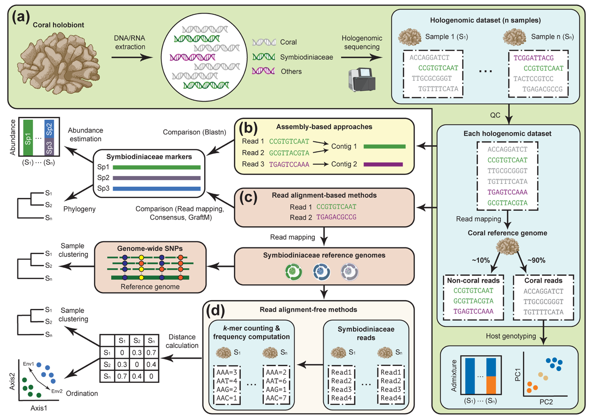
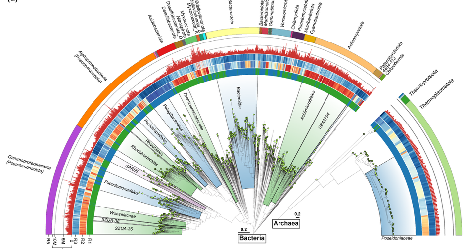

## Symbiodiniaceae hidden in coral hologenomes

::::: {.research-item}
::: {.research-text}
Coral hologenome data, generated by sequencing DNA from whole coral tissue, are dominated by host sequences, and the remaining 5 to 10% of reads are often discarded as "contaminant". We showed that this fraction is a goldmine: a PCR-free window into the endosymbiotic dinoflagellates (Symbiodiniaceae) living *in hospite*. We reviewed assembly-based, read alignment-based and alignment-free (k-mer) approaches, and using 148 hologenomes of *Acropora kenti* from the central Great Barrier Reef, resolved symbiont communities that track riverine influence. The workflow, Symb-SHIN, now scales to thousands of hologenomes.

Published in *Frontiers in Eukaryotic Microbiology*

[Read the paper →](https://doi.org/10.3389/frpro.2024.1376877){.paper-link}
:::

::: {.research-figure}
{fig-alt="Approaches for assessing Symbiodiniaceae communities from coral hologenome data"}
:::
:::::

## Diversity and metabolism of Great Barrier Reef sediment microbes

::::: {.research-item .reverse}
::: {.research-text}
Reef sediments are a hotspot of nutrient cycling, yet their microbes remain largely unexplored at genome level. From 191 sediment metagenomes collected at 48 sites along the Great Barrier Reef, we recovered 2,698 metagenome-assembled genomes representing 1,201 species, 98% of which have no species-level representative in reference databases. Compared with co-located seawater, sediment microbes have larger, GC-rich genomes and greater metabolic versatility, including anaerobic respiration, nitrogen fixation, hydrogen metabolism and novel biosynthetic gene clusters.

Preprint on *bioRxiv*

[Read the preprint →](https://doi.org/10.64898/2026.11.17.767448){.paper-link}
:::

::: {.research-figure}
{fig-alt="Phylogenomic tree of metagenome-assembled genomes from Great Barrier Reef sediments and seawater"}
:::
:::::
